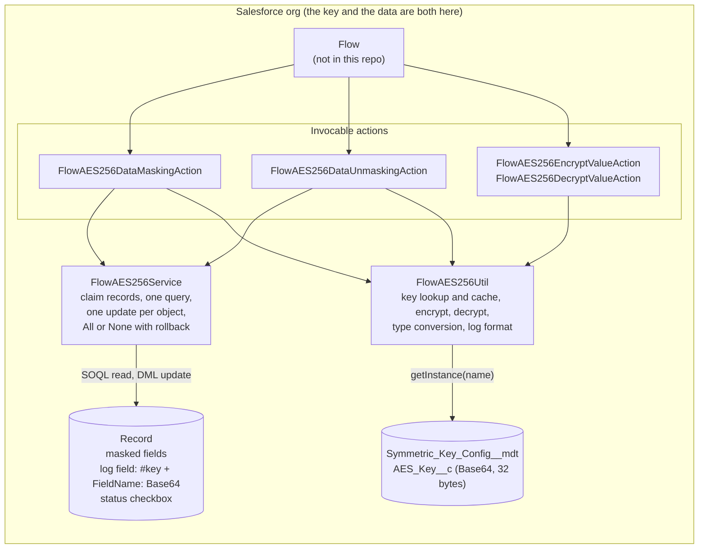

# salesforce-aes256-encryption-in-flow

Flow-callable Apex actions that encrypt chosen field values with AES-256 into a log field, mask the original fields, and restore them later, all inside Salesforce.

> **Status: proof of concept, unreviewed.** The encryption key is stored in the same org as the data. Nobody independent has reviewed the cryptography. Read [Limitations](#limitations) before using this on real data.

## Contents

1. [Summary](#summary)
2. [Use cases and non-use cases](#use-cases-and-non-use-cases)
3. [Architecture](#architecture)
4. [Key handling](#key-handling)
5. [Threat model](#threat-model)
6. [Design decisions](#design-decisions)
7. [Limitations](#limitations)
8. [Test steps](#test-steps)
9. [Demo](#demo)
10. [Security reporting](#security-reporting)
11. [Licence](#licence)

Supporting documents: [reference](docs/reference.md) (Flow inputs, field handling, limits, rotation), [full threat model](docs/threat-model.md), [claim-by-claim verification](docs/verification.md), [unverified items](docs/unverified.md) and the [demo script](docs/demo-script.md).

---

## Summary

Admins add invocable actions to a Flow. The masking action takes a collection of records and a list of field API names, encrypts each record's values with an AES-256 key read from Custom Metadata (`Symmetric_Key_Config__mdt`), writes the encrypted values to a log field as `FieldName: <Base64>` lines under a `#key: <name>` header, blanks the original fields (or writes a placeholder into required text fields) and ticks a status checkbox. The unmasking action reads the log, decrypts every line with the key it names, restores the values and clears the log. Two further actions encrypt and decrypt arbitrary text values. Processing is bulk-aware: all interviews in a transaction share one query and one update per object. The same key that encrypts also decrypts, and it is stored in the org, so this reduces *visibility* of the data in the user interface and in exports of the record fields; it does not protect against someone who can read the key.

## Use cases and non-use cases

**Suitable for**

- Hiding personal information (PI) in the record layout, reports and exports of records that have reached a defined stage, such as the end of a retention period, while keeping the ability to restore it inside Salesforce.
- Reducing accidental exposure to users who have record access but no access to Setup or to the key record.
- Learning and demonstration of Apex encryption, bulk-safe invocable actions and Flow integration.

**Illustrative scenario.** A Scheduled Flow selects contacts that meet a retention condition (for example no recent activity and no active ongoing commitment), checks parent-record dependencies (for example a roll-up on the parent account so that a contact is masked only when every sibling also qualifies), routes the set for manual approval by a data manager, and on the next scheduled run passes the approved records to the masking action. In practice the retention and grace periods should be tested against the organisation's own retention policy. This Flow is the author's design for illustration. It is **not** included in the repository and is not tested here.

**Not suitable for**

- Protecting data from administrators, developers or anyone able to read Custom Metadata or run Apex in the org. They can obtain the key and decrypt everything.
- Protecting data from an org-wide compromise, an export of the org's metadata, or a sandbox copy that includes the key record. For that, see the sister repository, [salesforce-hybrid-asymmetric-encryption-in-flow](https://github.com/jyltsang/salesforce-hybrid-asymmetric-encryption-in-flow), which keeps the decryption key off-platform but cannot restore data in the org.
- Detecting tampering with the log. The log is not authenticated.
- A compliance claim of any kind. Whether this satisfies a legal or regulatory requirement is a matter for your own assessment.
- Replacing Salesforce's own platform encryption, field-level security, sharing rules, backup controls or audit features. This project does not interact with them.
- Production use on regulated data without an independent security review.

## Architecture



Masking, per record:

1. Validate the request (fields exist, are editable and can be masked; log and checkbox have the right types; key is valid). Nothing is changed if validation fails.
2. Skip records whose checkbox is already ticked.
3. For each non-empty field, convert the value to text, encrypt it with `Crypto.encryptWithManagedIV('AES256', key, …)` and add a `FieldName: <Base64>` line to the log.
4. Write the log (with a `#key: <name>` first line), blank or replace the fields, tick the checkbox, and save.

Unmasking reverses this and clears the log, but only if every line decrypts and converts back.

## Key handling

| Item | Detail |
|---|---|
| **Where the key lives** | In the `AES_Key__c` field (Text, 255) of a `Symmetric_Key_Config__mdt` record, as a Base64 string. The default record is named `Default_Key`. Further records can be added as named keys (for example one per object or region) |
| **Visibility** | The type is declared `Public` in `Symmetric_Key_Config__mdt.object-meta.xml` |
| **Who can access it** | Treat the key as readable by: anyone with Setup access to Custom Metadata; any Apex code in the org (the code reads it with `getInstance`); anyone who retrieves or deploys metadata that includes the record; and any sandbox or backup that copies the record. Nothing in this repository restricts these routes |
| **How it is generated** | Outside Salesforce: `openssl rand -base64 32`, giving 44 characters that decode to exactly 32 bytes. The code rejects blank values, invalid Base64 and any length other than 32 bytes |
| **How it is used** | `FlowAES256Util.getKey` decodes it and caches it for the transaction. Keys are not stored anywhere else by this code, and the code does not log them |
| **In the log** | The log records the key's *name* (not the key) so unmasking picks the right key |
| **In source control** | The repository contains no key. `.gitignore` excludes retrieved Custom Metadata key records (`Symmetric_Key_Config.*`), `*.pem` and `*.key` so a retrieved record is not committed by accident |
| **In tests** | Tests inject freshly generated keys through `FlowAES256Util.setTestKey`, which bypasses the Custom Metadata lookup |

**Rotation** is manual. Create a new key record, point the masking action at it with **Key Name**, and keep the old record until every log written with it has been unmasked. Nothing re-encrypts existing logs. See [docs/reference.md](docs/reference.md#key-rotation-manual).

**Loss.** If a key record is deleted or changed, logs that name it cannot be decrypted, and the original values are lost.

## Threat model

Summary only. Scenarios, assumptions and unimplemented mitigations are in [docs/threat-model.md](docs/threat-model.md).

**Assets**

| Asset | Why it matters |
|---|---|
| Original PI values before masking | The data being protected |
| The log field | After masking, the only copy of the PI |
| The AES key records | Anyone holding a key can decrypt every log that names it |
| Apex classes, Flow configuration | Decide what is masked and who can restore it |

**Actors**

| Actor | Assumed capability |
|---|---|
| Standard user with record access | Reads masked records and the log field |
| Org administrator or metadata deployer | Reads Custom Metadata, edits Apex and Flows, runs the actions |
| Flow author | Chooses fields and settings passed to the actions |
| Insider with data-export rights | Obtains records, including log fields |
| Attacker with stolen org credentials | As the account they stole |

**Trust boundaries**

1. Users without Setup access / users with it. This is the only boundary the design relies on.
2. Flow / Apex action. Flow inputs are untrusted until validated.
3. Record data / log field. Anyone able to edit the log field can change it.

The org itself is **not** a boundary: key and data share it.

**Entry points**

| Entry point | Code |
|---|---|
| Masking, unmasking, encrypt and decrypt invocable actions | `FlowAES256DataMaskingAction`, `FlowAES256DataUnmaskingAction`, `FlowAES256EncryptValueAction`, `FlowAES256DecryptValueAction` |
| Key records | `FlowAES256Util.getKey` |
| Log field content | `FlowAES256DataUnmaskingAction.restoreRecord` |
| Field names from Flow, used in a dynamic query | `FlowAES256Service.queryRecords` (names are validated against object metadata first) |

**STRIDE**

| | Threat | State in this code | Residual |
|---|---|---|---|
| **S**poofing | Replace a key record so new masking uses a key the attacker knows | No detection | High for a metadata editor |
| **T**ampering | Edit, swap or replace log lines | AES in CBC mode with no MAC, nothing binds a line to its record or field. Unmasking fails cleanly when a line does not decrypt or convert (tested), but a line from another record encrypted with the same key would be accepted | High: not tamper-evident |
| **R**epudiation | Deny who masked or restored a record | The log holds encrypted values, not who or when. No action audit beyond platform features | Medium |
| **I**nformation disclosure | Read PI after masking | Anyone with the key decrypts everything. Field names, key name and which fields were non-empty are plain text in the log | **High** for administrators and Apex |
| **D**enial of service | Prevent restoring, or exhaust limits | Missing or changed key makes logs undecryptable. Bulk path shares queries and DML; CPU cost of encryption has not been measured | Medium |
| **E**levation of privilege | Use the actions to read or change data beyond the caller's rights | `with sharing` on the actions. Updateability of fields is checked. There is **no permission check on who may unmask** and the query is not run in user mode | Medium to high; access to the Flow and Apex classes is the only gate |

**Residual risks (not addressed by this code)**

- The key is as exposed as Custom Metadata is in your org.
- Unmasking is available to anyone who can run a Flow containing the action, and to any Apex that calls it.
- Logs are unauthenticated and not bound to their record or field.
- Original values that persist elsewhere: field history, exports, backups, integrations, search indexes and any copy made before masking.
- No independent review of the design or implementation.

## Design decisions

**Why AES-256 first.** The Apex `Crypto` class supports AES directly, so the whole mask-and-restore cycle can run inside Salesforce, from Flow, with no external service and no custom arithmetic. Keeping the key in Custom Metadata separates it from the code and from the repository, so deployments and commits carry no secret. A symmetric design also keeps the log compact and makes restoring simple. This repository's first commit is dated 27 September 2026, one day before its sister repository.

**Why the hybrid RSA-2048 with AES-256 envelope was added.** The weakness of this design is that the key is in the org. In the follow-up repository, [salesforce-hybrid-asymmetric-encryption-in-flow](https://github.com/jyltsang/salesforce-hybrid-asymmetric-encryption-in-flow), only an RSA public key is stored in Salesforce and the private key stays offline, so the org cannot decrypt.

| | This repository (AES only) | Hybrid repository |
|---|---|---|
| Key in the org | Yes (decrypts everything) | Public key only |
| Restore inside Salesforce | Yes | No (offline only) |
| Processing | Synchronous in the Flow transaction, bulk-aware | Asynchronous batch, RSA in Apex |
| Field names in the log | Plain text | Inside the ciphertext |
| Key rotation | Named keys, manual | None |
| Cryptographic primitives | Platform `Crypto` only | Platform `Crypto` plus custom big-number RSA with no padding |

**Other decisions visible in the code**

- *Validation before any change.* The masking action rejects a request outright if any field cannot be masked, so a typo never leaves PI unmasked silently.
- *Skip, never overwrite.* Re-masking an already masked record would replace the log with encrypted placeholders and lose the data, so such records are skipped.
- *Restore only if everything decrypts.* A record with an unreadable line stays masked with its log intact.
- *The log names its key.* This is what lets the default key be rotated without breaking older logs.
- *Bulk engine.* `FlowAES256Service` shares queries and updates across interviews, and retries a failed All-or-None batch without the failing request (at most 3 attempts) to respect Salesforce governor limits.

## Limitations

This list is intentionally longer than the claims above.

**Security design**

1. **No independent cryptographic or security review has been done.**
2. **The key is in the org.** Whoever reads the key record, or runs Apex that reads it, decrypts every log naming it. Visibility is `Public`.
3. **No authentication of the log.** AES in CBC mode with no MAC, and nothing ties a line to its record or field. Edited lines can fail to decrypt, but a valid ciphertext from another record or field encrypted with the same key would be accepted and restored there. Decrypting with a wrong key normally fails the padding check, but the unit test `testDecryptWithWrongKeyFails` accepts either an error or a wrong result, because by chance a wrong key can occasionally produce valid padding and garbage output.
4. **No permission gate on unmasking.** Access depends on who can run the Flow or call the Apex classes. The code does not check a permission or role, and the dynamic query is not run in user mode.
5. **Metadata is exposed.** Field API names, the key name, the number of logged fields and which fields were empty are visible in the log. The status checkbox shows which records are masked, and placeholders show which required fields were masked.
6. **Platform behaviour is assumed.** The cipher mode and padding behind `Crypto.encryptWithManagedIV('AES256', …)` are not shown by this repository.

**Keys**

7. **Rotation is manual and incomplete.** Nothing re-encrypts existing logs. Old key records must stay until every log naming them has been unmasked.
8. **Key loss means data loss.** Deleting or editing a key record makes its logs unreadable. There is no escrow or backup.
9. **Key exposure routes are not controlled here.** Metadata retrieval, deployment, sandbox refresh and backups can carry the key. The `.gitignore` only protects this repository.

**Operation**

10. **Records marked masked can still hold PI in other places.** Field history, exports, backups, files, notes and integrations are not handled. Original data that reached those before masking stays there.
11. **Some fields cannot be masked.** Compound address and geolocation fields, binary fields, read-only fields and required non-text fields (for example a required picklist) are rejected, which stops the whole request.
12. **Unmasking overwrites.** Restored values replace whatever the target fields hold at that time, including edits made after masking.
13. **Log capacity.** A record fails if its log does not fit the log field. A rich text area is accepted but gives no benefit.
14. **Bulk limits.** The bulk test covers 200 interviews of 10 fields each. Larger volumes, other objects, and orgs with many triggers, flows or validation rules on the target object have not been tested in the repository. Performance and CPU cost are unmeasured.
15. **Cross-record failure handling.** If the same record appears in two requests in one transaction, the second fails. A database failure in an All-or-None request triggers up to three save attempts. If these are exhausted the remaining requests are rejected.

**Scope and evidence**

16. **The Flow is not in the repository.** Flow wiring, scheduling, the approval step and the retention logic are untested here.
17. **Apex tests use standard Contact and Lead fields** and injected keys. They do not exercise the Custom Metadata lookup, any permission model, or any managed-package or nonprofit data model.
18. **Test results are author-reported.** The author reports the tests passed in a sandbox; no log or coverage report is stored.
19. **The "audit log" is a recovery record, not an audit trail.** It holds encrypted values, not who masked or restored a record, or when.
20. **Compliance.** Nothing here has been assessed against any law or standard.

## Test steps

**Prerequisites:** a sandbox or scratch org you may change, Salesforce CLI (`sf`), `openssl`. Use **dummy data only**.

1. **Authenticate.**

   ```bash
   sf org login web --alias aes-test --instance-url https://test.salesforce.com
   ```

2. **Deploy and run the unit tests.**

   ```bash
   sf project deploy start --source-dir force-app --target-org aes-test \
     --test-level RunSpecifiedTests \
     --tests FlowAES256UtilTest --tests FlowAES256DataMaskingActionTest \
     --tests FlowAES256DataUnmaskingActionTest --tests FlowAES256BulkTest \
     --tests FlowAES256ValueActionsTest
   ```

   Expected: deployment succeeds and the five test classes (52 test methods) pass. They use standard Contact and Lead fields (`Description` as the log field and `DoNotCall` as the status checkbox) and supply their own keys, so no custom fields or key record are required. `FlowAES256BulkTest` also converts a Lead and needs a converted Lead Status. Validation rules, required custom fields or triggers on Contact or Lead in your org may need test adjustments.

3. **Generate a key and create the key record.**

   ```bash
   openssl rand -base64 32
   ```

   Expected: one line of 44 characters. In *Setup → Custom Metadata Types → Symmetric Key Config → Manage Records → New*: label `Default Key`, name `Default_Key`, AES Key = the 44 characters. Do not paste the key anywhere else, and never commit it.

4. **Create fields on Contact:** a Long Text Area for the log (131,072 characters), for example `Mask_Log__c`, and a checkbox, for example `Data_Masked__c`.

5. **Create a dummy Contact:** last name `Demo Person`, email `demo.person@example.com`, a made-up mailing street and postcode.

6. **Build the masking Flow (Screen Flow).** *Get Records* (Contact where Last Name equals `Demo Person`, all records) → *Assignment* adding `Email`, `MailingAddress` and `LastName` to a Text Collection → *Action* **AES256 Encrypt and Mask Record Fields** with Object = the record collection, Fields Name = the text collection, Log Field = `Mask_Log__c`, Checkbox Field = `Data_Masked__c`. Show the action's **Message** output on a final screen.

7. **Run it.** Expected message: `SUCCESS: Processed 1 records.` On the Contact: email and street blank, last name `*****`, `Data_Masked__c` ticked, and `Mask_Log__c` starting `#key: Default_Key` followed by `Email: …`, `MailingStreet: …` lines of Base64.

8. **Run it again.** Expected: `SUCCESS: Processed 0 records. Skipped 1 already masked records.` and the log is unchanged.

9. **Build the unmasking Flow:** the same *Get Records*, then **AES256 Decrypt and Unmask Record Fields** with Log Field and Checkbox Field as above. Run it. Expected: `SUCCESS: Unmasked 1 records.`, original values restored, log empty, checkbox unticked.

10. **Negative check (wrong key).** Mask again, then change the `AES Key` of `Default_Key` to a different valid 44-character key and run the unmasking Flow. Expected (a wrong key almost always fails the padding check; see Limitation 3): the Flow reports `ERROR:` with `could not decrypt … with key Default_Key; the log may have been altered or the key changed`, the Contact stays masked and the log is unchanged. Restore the original key afterwards.

11. **Rotation check.** Create `Key_Test` with a new key. Run masking with **Key Name** = `Key_Test`. Expected: the log starts `#key: Key_Test`. Run unmasking without a key name. Expected: restored, because the log names its key.

12. **Clean up.** Delete the dummy Contact and the test key records.

## Demo

A numbered script for a 3 to 5 minute screen recording is in [docs/demo-script.md](docs/demo-script.md).

**Recording link:** _to be added (placeholder)_

## Security reporting

Please report vulnerabilities by opening an issue in this repository's **Issues** tab with the title prefix `Security:`. The issue will be public, so:

- describe the weakness and the affected file or function;
- **do not** include real personal data, keys, tokens or a working exploit;
- if you need to share sensitive details, say so in the issue and the maintainer will arrange a private route.

This is a proof-of-concept project with no service-level commitment. If GitHub's private vulnerability reporting is enabled on the repository, you may use it instead.

## Licence

MIT. The [`LICENSE`](LICENSE) file is present in the repository root.
